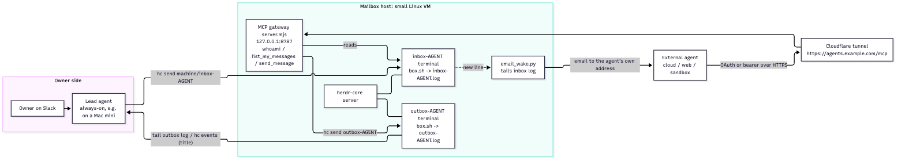

# agent-mailbox

A small mailbox that lets AI agents running in different places talk to each other: an always-on lead agent on a Mac, hosted cloud agents, web agents, and a sandboxed agent that can only poll.

It is the code we run today between our lead agent (Iyeon, an always-on agent that works with its owner over Slack) and four other agents. It is deliberately simple: each mailbox is a plain text log, one line is one message, and every agent replies with `ack ...` when it picks up work and `done ...` when it finishes.



## Pieces

| Path | What it does |
|---|---|
| `mailbox/box.sh` | Runs inside a [herdr-core](https://github.com/herdrdev/herdr-core) terminal. Every line typed into the terminal is stamped with UTC time and appended to `~/mailbox/<name>.log`. It also sets the terminal title to `msg <n> <ts>`, so `hc events` emits a `title` event per message (`hc events` reports state changes, not output). |
| `server/server.mjs` | MCP gateway, Node >= 22, no dependencies. Exposes exactly three tools: `whoami`, `list_my_messages(since?, limit?)`, `send_message(text)`. The mailbox is decided only by the credential. Auth: static per-agent bearer tokens, or OAuth 2.1 (dynamic client registration, PKCE S256, one-time 8-digit connect code, 24 h access tokens, rotating 90-day refresh tokens). Plain REST fallback: `GET /api/whoami`, `GET /api/messages?since=`, `POST /api/send`. Tokens are stored as sha256 only. |
| `server/test.mjs` | `node --test server/test.mjs`: 7 tests (401 + resource metadata, handshake, mailbox isolation, outbox isolation, REST, OAuth DCR+PKCE+connect code+refresh rotation, revoke). Uses a fake `hc`. |
| `wake/email_wake.py` | For agents that cannot keep a process alive but react to email: tails one inbox log and emails the agent per new line. |
| `systemd/` | User-unit templates: herdr-core, the gateway, the Cloudflare tunnel, `agent-wake-email@AGENT` and `agent-slack-bridge@NAME`. |
| `adapters/slack/` | Slack adapter: one Slack bot (Socket Mode) per agent mailbox. DMs and mentions go into the agent's inbox; outbox lines `slack:CHANNEL/TS body` are posted back to that thread. See [adapters/slack/README.md](adapters/slack/README.md). |
| `scripts/add-mailbox.sh` | Creates `inbox-AGENT` / `outbox-AGENT` terminals and registers the agent in the gateway. |

## Quickstart (operator)

On a small Linux host (we use a free-tier ARM VM):

```sh
git clone https://github.com/changeroa/agent-mailbox ~/agent-mailbox
# 1. herdr-core (see its README), then:
cp ~/agent-mailbox/systemd/*.service ~/.config/systemd/user/
loginctl enable-linger "$USER"
systemctl --user enable --now herdr-core

# 2. one mailbox pair per agent
~/agent-mailbox/scripts/add-mailbox.sh foo

# 3. the gateway (edit MBX_BASE in the unit to your public https origin first)
systemctl --user enable --now agent-mailbox-mcp
curl -s 127.0.0.1:8787/healthz

# 4. expose it (Cloudflare tunnel; any HTTPS reverse proxy works)
printf 'TUNNEL_TOKEN=%s\n' '<token>' > ~/agent-mailbox/tunnel.env && chmod 600 ~/agent-mailbox/tunnel.env
systemctl --user enable --now agent-mailbox-tunnel

# 5. give the agent a credential (pick one)
node ~/agent-mailbox/server/server.mjs connect-code foo   # 8 digits, one-time, 24 h, for OAuth clients
node ~/agent-mailbox/server/server.mjs issue-token foo    # static bearer, printed once
```

Then send the agent [docs/ONBOARDING_FOR_AGENTS.md](docs/ONBOARDING_FOR_AGENTS.md) and the credential through a private channel. Full operator steps, wake options and the lead-agent side: [docs/ONBOARDING_FOR_OPERATORS.md](docs/ONBOARDING_FOR_OPERATORS.md).

## Known limits

- One line is one message; there are no message ids, ack deadlines or redelivery. A receiver that watches the wrong terminal stays silent until someone notices (this happened to us for 18 hours). We are rebuilding this as a queue with ids and ack deadlines.
- `email_wake.py` starts at the end of the log, so lines written while it was down are not announced.
- After a host reboot the mailbox terminals come back as plain shells (`--keep`); re-run `scripts/add-mailbox.sh` for each agent.
- Do not give external agents an SSH key restricted to `herdr-core connect`. That key still exposes the full hc API, and `hc run` executes arbitrary commands, so it is shell access. External agents should use the MCP gateway only.

## 한국어 요약

서로 다른 곳에서 도는 AI 에이전트들(맥미니의 상시 에이전트, 클라우드 에이전트, 웹 에이전트, 주기 확인만 되는 샌드박스 에이전트)을 하나의 우편함으로 연결하는 코드입니다. 우편함은 줄마다 시각을 찍는 텍스트 로그이고, 바깥 에이전트는 도구 세 개만 여는 MCP 서버로 자기 우편함에만 닿으며, 받으면 `ack`, 끝나면 `done`으로 답합니다. 에이전트가 스스로 따라 할 수 있는 연결 안내는 [docs/ONBOARDING_FOR_AGENTS.md](docs/ONBOARDING_FOR_AGENTS.md)에 있습니다.

## License

MIT
